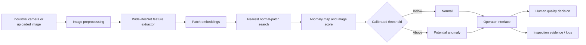

# Solution Architecture

## Functional flow

## Component responsibilities

- **Acquisition layer:** provides RGB inspection images under controlled conditions.
- **Preprocessing:** normalizes size and color values consistently with the feature extractor.
- **Intelligent component:** compares local deep features with a normal-only memory bank.
- **Decision-support layer:** applies a threshold calibrated on validation data.
- **Interface:** shows the original evidence, heatmap overlay, anomaly score, and latency.
- **Human control:** the quality operator remains responsible for acceptance/rejection decisions.

## Design rationale

The architecture separates model capability from the operational process and the responsible decision. This prevents the model output from being treated as an unquestionable production decision.
