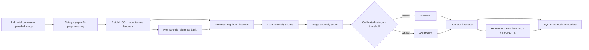

# VisionGuard AI — Solution Architecture

## Deployed inference path

## Main software components

### 1. Web frontend
`web/index.html`, `web/styles.css`, and `web/app.js` provide three views:

- Inspection;
- Performance;
- System.

### 2. FastAPI service
`webapp.py` provides the user interface backend and API endpoints for:

- inspection;
- health/readiness;
- model registry status;
- benchmark evidence;
- inspection history/statistics;
- human review.

### 3. Model registry
`src/model_registry.py` loads configured model artifacts on demand, caches them, verifies availability, exposes threshold provenance, and computes an artifact SHA-256 fingerprint.

### 4. Deployed anomaly detector
`src/hog_anomaly_detector.py` + `src/hog_features.py` implement the verified Patch-HOG kNN inference path.

Each category has:
- a generated normal memory bank;
- a calibrated threshold;
- a configuration entry.

### 5. Traceability storage
`src/storage.py` stores inspection metadata in SQLite:

- inspection ID;
- timestamp;
- category;
- engine;
- model artifact hash;
- source filename;
- image SHA-256 hash;
- model decision;
- score;
- threshold;
- latency;
- optional operator decision.

Raw images are not persisted by default.

## Decision separation

The architecture deliberately separates:

1. **model capability** — produce anomaly evidence;
2. **operational workflow** — acquisition, scoring, visualization, logging;
3. **responsible decision** — a human operator accepts, rejects, or escalates the part.

## Experimental path

A pretrained Wide-ResNet deep-patch implementation exists as an experimental candidate. It is not the current verified deployment engine and is not used to claim the reported Patch-HOG results.

## Deployment boundary

Docker/Compose demonstrate packaging and local/on-premise operation. A real industrial deployment still requires authentication, TLS, camera and PLC/MES integration, monitoring, backup, change control, drift detection, and validation on the target production line.
